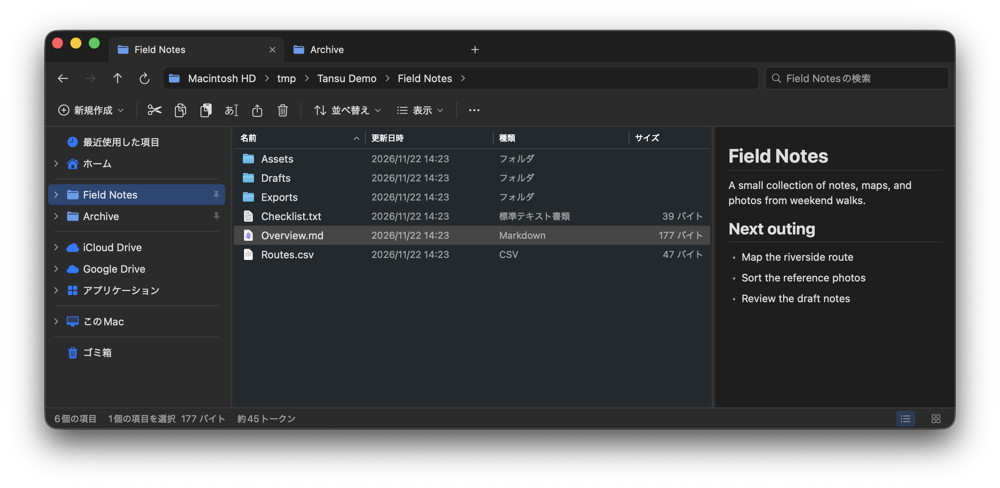

# Tansu

Tansuは、Windowsのエクスプローラーに慣れた人向けのmacOSファイルマネージャーです。
タブとアドレスバーでフォルダを行き来し、F2で名前を変え、Enterでファイルを開けます。

**[Tansuをダウンロード（DMG）](https://github.com/yoshimple/tansu/releases/latest/download/Tansu.dmg)**

macOS 14以降 · Apple Silicon／Intel

## インストール

1. ダウンロードした `Tansu.dmg` を開きます。
2. ウィンドウ内の `Tansu.app` を `Applications`（アプリケーション）のショートカットへドラッグします。
3. 「アプリケーション」フォルダからTansuを開き、使いたいフォルダへのアクセスをmacOSに尋ねられたら許可します。

## 主な機能

- タブ、アドレスバー、サイドバーでフォルダを移動し、ファイルを詳細・アイコン表示で確認
- クイックルック、Spotlightでのファイル名検索、タグ、iCloud Drive
- ファイル操作の取り消し、ゴミ箱への移動、ZIPの作成と展開
- 選択したファイルのパスや内容をコピーし、選択したフォルダでClaude CodeやCodexを起動
- 対応するアプリの「Finderで表示」をTansuで開く設定

## 基本操作

| 操作 | キー |
| --- | --- |
| 開く | Enter |
| 名前を変更 | F2（環境により fn+F2） |
| コピー・切り取り・貼り付け | Cmd+C／Cmd+X／Cmd+V |
| 元に戻す | Cmd+Z |
| クイックルック | Space |
| 新しいタブ | Cmd+T |

ショートカット一覧、アクセス権限、「Finderで表示」の設定と戻し方は[利用ガイド](docs/usage.md)を参照してください。

## 開発と問い合わせ

Xcode 16以降でソースからビルドできます。[開発ガイド](docs/development.md)にビルド、テスト、配布の手順があります。不具合報告や機能提案は[GitHub Issues](https://github.com/yoshimple/tansu/issues)にお寄せください。

## ライセンス

[MIT License](LICENSE)
